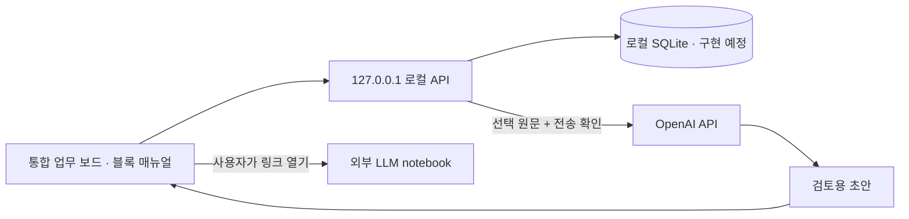

# 아키텍처와 저장소 구성

현재 JavaScript UI와 Node.js HTTP 서버를 유지하며 저장 계층을 순차적으로 추가한다. 프레임워크 전환을 먼저 수행하지 않는다. Node.js 24 계열의 내장 SQLite 기능을 목표 저장 계층과 스키마 검사에 사용한다.

| 위치 | 책임 |
| --- | --- |
| `public/` | 보드, 항로·서무 상세, 페이지 편집, 마법사 UI |
| `public/schedule.js` | 달력·선박 주기와 기한 정렬의 공통 계산 |
| `server.js` | 현재 HTTP 서버, 로컬 접근 제한, 마법사 API |
| `lib/` | 서버 측 AI 처리. DB 저장 서비스는 후속 구현 |
| `database/migrations/` | SQLite 초기 스키마. 앱에서 아직 실행하지 않음 |
| `config/` | 검증 가능한 목표 설정. 현재 서버의 자동 설정 로더는 아님 |
| `scripts/` | 저장소 검증과 Windows 실행 지원 |
| `tests/` | 도메인·보안·스키마 검증 |
| `docs/` | 확정 요구사항, 데이터 모델, 운영·구현 계획 |
| `.github/workflows/` | Linux·Windows CI 정의 |

## 현재 런타임

UI는 샘플 데이터와 localStorage를 사용한다. API는 `/api/session`, `/api/wizard`만 구현되어 있다. 계약 Notebook URL 저장·열기는 미구현이며 Contract ID 안내만 표시한다. 보드는 예시 기준일 2026-10-13을 사용한다. 실제 API 호출은 키가 필요하며 실 API와 Windows 실행 검증을 별도로 수행해야 한다.

## 로컬 저장 계층의 다음 구현

환경 경로를 해석하고 `%LOCALAPPDATA%\Worknote` 아래에 데이터·백업 폴더를 만든다. 스키마 버전 확인 후 미적용 migration을 트랜잭션으로 적용한다. 작업 데이터와 매뉴얼의 저장 책임을 나누고 History 추가와 해당 업데이트 정보 변경을 원자적으로 처리한다. 브라우저 원본을 보존한 채 사용자 확인 후 이전한다.

추가할 API는 업무 노드 CRUD, 항로 History, 계약 참조와 관계 연결, 매뉴얼 페이지 저장이다. Due date는 저장된 원문 날짜·주기에서 계산하며 AI나 클라이언트가 보낸 기한을 정답으로 저장하지 않는다. SQL view는 최근 업데이트 기준을 통일하고 날짜 계산은 공통 달력 규칙을 따른다.

API 키는 현재 임시 프로세스 환경으로 전달한다. 다음 단계에서 Windows 보안 저장소를 붙이며 일반 설정 JSON이나 DB에 키를 저장하지 않는다. 외부 AI 응답은 실행 권한을 갖지 않는다.

## 백업과 프로세스

파일·DB는 남지만 서버 프로세스와 세션 토큰은 재시작마다 다시 생긴다. DB 도입 전 현재 페이지 백업은 평문 JSON이다. 이후 SQLite 백업 API, 암호화와 복원 점검을 추가한다. 라이브 DB 파일만 복사하거나 체크아웃에 DB를 포함하지 않는다.
