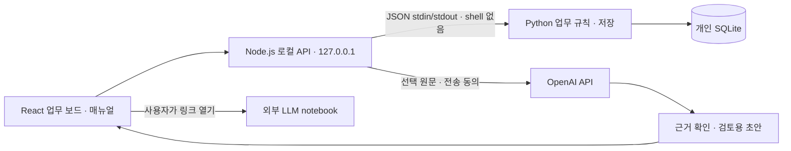

# 아키텍처와 저장소 구성

사용자 지정 스택은 Python + React + SQLite + Node.js다. Python이 업무 규칙과 저장을 담당하고 Node.js가 HTTP 서버와 GPT 호출을 담당한다. React는 같은 로컬 서버에서 제공하는 빌드된 UI다.

| 위치 | 책임 |
| --- | --- |
| `frontend/` | React 보드, 업무 생성·상세, 매뉴얼, 마법사, 기존 자료 이전 |
| `backend/domain.py` | 입력 검증, 달력·선박 주기, Due date·D-day 계산 |
| `backend/worker.py` | SQLite 스키마 확인, 노드·History·참조·매뉴얼의 트랜잭션 저장 |
| `lib/python-store.js` | 저장 경로 선택, 고정 Python 작업 프로세스와 UTF-8 JSON 통신 |
| `server.js` | HTTP, 인증·Host·Origin·CSP, Node API 라우팅 |
| `lib/wizard.js` | 선택 원문만 외부 GPT에 전송, 초안 형식·근거 검증 |
| `public/` | 공유 표시 모델·스타일, Markdown 이전 도구, 이전 UI 소스 |
| `database/migrations/` | Python 초기화 시 적용하는 SQLite 스키마 |
| `config/` | 검증 가능한 기본 설계. 런타임에서 자동 로딩하지 않음 |

## 저장과 API

첫 실행에 DB를 체크아웃 밖에 만들고 초기 스키마를 적용한다. 이미 데이터가 있으면 보존하고 지원하지 않는 형식·버전은 거절한다. 매번 작업별 Python 프로세스가 DB를 열고 닫는다. 개인 사용 규모의 단순한 구조이며 큰 데이터의 처리 성능은 후속 검토 대상이다. SQLite는 외래 키·WAL·쓰기 트랜잭션을 사용한다.

| API | 동작 |
| --- | --- |
| `GET /api/session` | 앱 요청 토큰과 GPT 설정 유무 |
| `GET /api/nodes` | 혼합 업무 목록, 한국 시간 기준일, Python이 계산한 기한 |
| `POST /api/nodes` | Route 또는 서무 업무 생성 |
| `PATCH /api/nodes/:id` | 항로 종료·Remark 또는 서무 날짜·주기·가이드 변경 |
| `POST /api/nodes/:id/history` | Route 내부 이력 추가 |
| `GET/PUT /api/nodes/:id/manual` | 독립 블록 페이지 읽기·저장 |
| `POST /api/nodes/:id/contracts` | Contract 참조·HTTPS Notebook 링크 저장·연결 |
| `POST /api/demo` | 빈 DB에만 가상 예시 입력 |
| `POST /api/import` | 사용자 확인한 브라우저 자료를 원자적으로 이전 |
| `POST /api/wizard` | 전송 동의한 원문을 GPT로 정리 |

세션을 제외한 API는 앱 토큰을 요구한다. 실제 Due date는 저장된 날짜·주기에서 Python으로 계산하며 클라이언트나 AI가 보낸 기한을 저장하지 않는다. UI에는 파생 값을 표시한다. 매뉴얼 저장 회차와 업무 수정 시각으로 오래된 화면의 덮어쓰기를 거절한다. 삭제 API는 제공하지 않는다.

## 이전과 운영

기존 브라우저 저장은 읽기만 하며 사용자가 대상을 확인해야 이전한다. ID 충돌·손상 자료는 덮어쓰지 않고 트랜잭션을 취소한다. Markdown 매뉴얼은 블록으로 변환하되 원본 키를 보존한다. 같은 브라우저와 기존 Origin에서 열어야 이전 데이터가 보인다. React 빌드 결과는 `dist/`에 생성하며 Node 서버만 실행한다. 개발 중에는 별도 터미널에서 `npm run ui:watch`로 빌드를 갱신한다.

API 키는 Node 프로세스 환경에만 두고 Python에 전달하지 않는다. Notebook은 자동 조회하지 않는다. GPT 결과는 검토용 초안이며 DB 변경을 실행하지 않는다. DB 파일은 재시작 후 남고 세션 토큰은 재생성된다. Windows 키 보호·암호화 DB 백업·알림·설치 패키징은 후속 작업이다.
