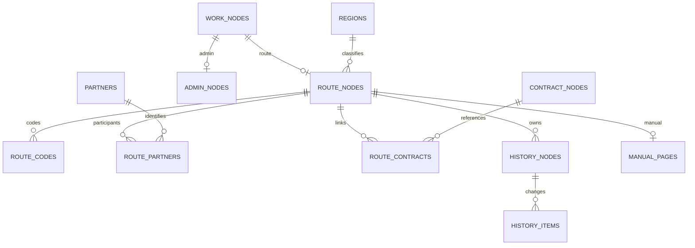

# 데이터 모델

[초기 SQL](../database/migrations/001_initial.sql)은 Python 저장 계층이 빈 로컬 DB에 실제 적용하는 스키마다. 기존 DB는 버전을 확인하며 초기화로 덮어쓰지 않는다. 기밀 계약 원문을 담는 테이블은 없다.

- `work_nodes`: 공통 ID·업무명·종류·주기. 항로명에 고유 제약을 걸지 않는다.
- `route_nodes`: 계약 유형, 권역, 계약 시작·종료 월, 종료 사유와 비고.
- `route_codes`: 항로 코드 목록과 표시 순서. 교환의 두 코드 표시 규칙은 서비스 계층에서 검증한다.
- `regions`: 권역명, 상위 지리 그룹, 표시 분류명.
- `partners`, `route_partners`: 선사 코드와 참여 역할.
- `contract_nodes`, `route_contracts`: 최소 계약 참조 정보와 Route 연결. URL의 정식 HTTPS 검증은 서비스 계층에서 수행한다. SQL은 접두사만 검사한다.
- `history_nodes`, `history_items`: Route 내부 업데이트 날짜·적용 Cycle·Remark·변경 항목.
- `admin_nodes`: 고정 분류, 최근 업데이트 날짜, 가이드라인.
- `manual_pages`: Route ID별 하나의 블록 문서. 실제 이전 버전 보관은 후속 설계이며 `revision`은 저장 회차다.
- `work_node_summary`: 항로는 History 최대 날짜, 서무는 직접 기록한 업데이트 날짜를 사용하는 view. 종료 항로에는 업데이트용 Due date를 계산하지 않는다.

기한과 D-day는 파생 값이며 DB에 고정 저장하지 않는다. 실제 날짜 유효성·블록 형식·URL·공백·교환 코드 개수·소유 종류는 API에서도 검증한다. SQL의 형식 검사는 이를 대체하지 않는다. 앱이 하나의 트랜잭션에서 공통 노드와 종류별 레코드를 함께 생성해야 한다.

스키마는 SQLite 외래 키와 CHECK로 기본 관계를 제한한다. 테이블 데이터 삭제는 RESTRICT로 보호하며 실제 삭제·보관 정책은 서비스에서 명시한다. 시각은 UTC, 계약 시작·종료는 초기 UI에 맞춰 월 단위, 업데이트 날짜는 일 단위로 기록한다.

검토한 Excel 수입 파일에는 [선택적 출처 테이블](../database/imports/excel_sources.sql)을 추가할 수 있다. `imported_route_schedules`는 원문 주기와 계산된 일수를 보존한다. 공통 노드에 달력/선박 주기가 없으면 Python이 이 테이블의 일수를 읽어 원래 Excel 기한을 계산한다. `imported_page_sources`는 기본 페이지와 흡수된 BSA 페이지를 같은 Route ID에 연결하며, `imported_history_sources`는 공유 History의 원본 행을 보존한다. 계약 본문·첨부는 저장하지 않는다. 실제 페이지 본문 대신 원본 링크와 검토된 메타데이터를 담은 매뉴얼 페이지를 저장할 수 있다.
